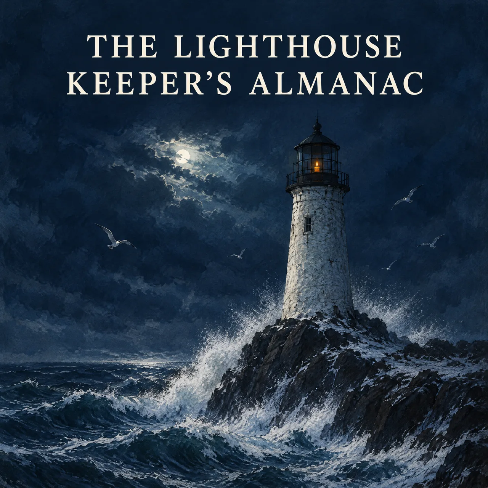

# AI Audiobook Generator Skill

English | [简体中文](./README.zh-CN.md) | [日本語](./README.ja.md)

> 👉 See also [AI Podcast Voiceover Skill](https://github.com/beatra-ai/ai-podcast-voiceover-skill)

Turn a final manuscript or course text into ordered chapter audio with one narrator, a representative sample chapter first, and focused refinements, from inside Claude Code, Cursor, Codex, Windsurf, Cline, or OpenClaw.

> [!IMPORTANT]
> Rendering needs a [Beatra](https://beatra.ai?utm_source=github&utm_medium=flagship&utm_campaign=ai-audiobook-generator-skill) account and uses credits. The skill itself is free to install.

| Question | Answer |
| --- | --- |
| **What it does** | Turn final manuscript or course text into ordered chapter audio with one narrator, a representative sample, clear pricing, and focused refinements. |
| **Models** | MiniMax Speech 2.8 HD, MiniMax Speech 2.8 Turbo, Doubao Seed TTS 2.0, ElevenLabs v4 Turbo, ElevenLabs v4, MiniMax Voice Clone, Qwen Image 3.0, MiniMax H3 Image, Qwen Image 2.0 Fast, Qwen Image 3.0 Pro, GPT Image 2.5 Flare, GPT Image 2.5 Sunburst, GPT Image 2, Wan Image 2.7 Fast, Qwen Image 2.0 Pro, Wan Image 2.7 Pro |
| **Requirements** | Python 3.10+ and an agent that loads `SKILL.md` |
| **Cost** | Free to install. Each render uses credits on your Beatra account, and paid steps run only when you ask for that exact render or approve its card. |
| **Works with** | Claude Code, Cursor, Codex, Windsurf, Cline, OpenClaw |

<p align="center"></p>

*Listing cover for The Lighthouse Keeper's Almanac, an invented novella, showing a storm-battered lighthouse lit by a single candle. AI-generated with Beatra.*

| Skill | Entry point | Version |
| --- | --- | --- |
| [`ai-audiobook-narration`](skills/ai-audiobook-narration) | [SKILL.md](skills/ai-audiobook-narration/SKILL.md) | 0.3.3 |

This repository is published automatically from [beatra-ai/beatra-skills](https://github.com/beatra-ai/beatra-skills/tree/main/skills/ai-audiobook-narration). Report issues there.

Also known as `ai-audiobook-generator` (installed under the Beatra slug `ai-audiobook-narration`).

## Install

With the [`skills`](https://skills.sh) CLI:

```bash
npx skills add beatra-ai/ai-audiobook-generator-skill
```

As a Claude Code plugin:

```bash
claude plugin marketplace add beatra-ai/ai-audiobook-generator-skill
claude plugin install ai-audiobook-narration@ai-audiobook-generator-skill
```

As a Codex plugin:

```bash
codex plugin marketplace add beatra-ai/ai-audiobook-generator-skill
codex plugin add ai-audiobook-narration@ai-audiobook-generator-skill
```

As a GitHub Copilot CLI plugin:

```bash
copilot plugin marketplace add beatra-ai/ai-audiobook-generator-skill
copilot plugin install ai-audiobook-narration@ai-audiobook-generator-skill
```

As a Gemini CLI extension:

```bash
gemini extensions install https://github.com/beatra-ai/ai-audiobook-generator-skill
```

As an Antigravity CLI plugin:

```bash
agy plugin install https://github.com/beatra-ai/ai-audiobook-generator-skill
```

With the GitHub CLI:

```bash
gh skill install beatra-ai/ai-audiobook-generator-skill ai-audiobook-narration
```

Or clone this repository and copy `skills/ai-audiobook-narration` into `~/.claude/skills/` for Claude Code,
`~/.cursor/skills/` for Cursor, `~/.agents/skills/` for Codex, `~/.codeium/windsurf/skills/` for Windsurf,
`~/.cline/skills/` for Cline, or `~/.openclaw/skills/` for OpenClaw.

Or paste this into your agent:

```text
Install the ai-audiobook-narration skill from https://github.com/beatra-ai/ai-audiobook-generator-skill (folder skills/ai-audiobook-narration), then follow its SKILL.md to connect my Beatra account.
```

Tested in clean-room CI: Antigravity CLI (2026-11-09).

## Examples

<p align="center"></p>

[▶ Listen (MP3)](assets/sample.mp3)

*Representative sample chapter from an invented novella, The Lighthouse Keeper's Almanac, read in 43 seconds by one narrator voice with dialogue and recurring names. AI-generated with Beatra.*

Ask your agent:

```text
Narrate ./almanac-manuscript.md as an audiobook with one narrator voice. Start with a representative sample from chapter one so I can check the pacing and how the names are pronounced before you do the rest.
```

Prompt:

```text
The Lighthouse Keeper's Almanac. Chapter one: the night the lamp went dark.

On the ninth of November, at a quarter past two in the morning, the lamp at Gullrock Point went out. Maren Holloway had kept that light for eleven winters, and it had never once failed her.

She climbed the hundred and six iron steps with a candle cupped in her hand. Outside, the wind worked at the glass like a patient thief.

"Tobias," she called down the stairwell, "bring the spare wick, and bring the almanac."

Her nephew's voice came up thin and frightened. "The almanac says nothing about tonight, Aunt Maren."

"Then we shall write tonight into it," she said, and struck the match.
```

## Inputs and outputs

| | Type | Formats | Specifications |
| --- | --- | --- | --- |
| **Input** | Text — Final manuscript or course text in chapter order | — | — |
| **Input** | Audio — Narrator sample for your own cloned voice (optional) | — | 10–300 s; up to 20 MB each |
| **Output** | Audio — Chapter audio in listening order, read by one narrator | MP3 | 40 languages |
| **Output** | Image — Listing cover (optional) | PNG | 1 image per request |

## Technical Specifications & Output Limits

As of 2026-11-14. Live list: https://docs.beatra.ai/en/docs/models

- **Uploads** — up to 100 MB per file; the per-model input limits below also apply
- **Text to speech** — 5 models (MiniMax Speech 2.8 HD, MiniMax Speech 2.8 Turbo, Doubao Seed TTS 2.0, ElevenLabs v4 Turbo, ElevenLabs v4); FLAC, MP3, OPUS, PCM, WAV; 40 languages; sample rates 8, 16, 22.05, 24, 32, 44.1 kHz; up to 50000 characters per request
  - Languages (ISO 639 codes): zh, yue, en, es, fr, ru, de, pt, ar, it, ja, ko, id, vi, tr, nl, uk, th, pl, ro, el, cs, fi, hi, bg, da, he, ms, fa, sk, sv, hr, fil, hu, no, sl, ca, nn, ta, af
- **Voice cloning** — 1 model (MiniMax Voice Clone); sample 10–300 s, up to 20 MB; consent attestation required
- **Text to image** — 10 models (Qwen Image 3.0, MiniMax H3 Image, Qwen Image 2.0 Fast, Qwen Image 3.0 Pro, GPT Image 2.5 Flare, GPT Image 2.5 Sunburst, GPT Image 2, Wan Image 2.7 Fast, Qwen Image 2.0 Pro, Wan Image 2.7 Pro); PNG; up to 4 images per request; canvas up to 16.8 MP
  - 16.8 MP (4K tier): MiniMax H3 Image, Wan Image 2.7 Pro (up to 4 images per request); GPT Image 2.5 Flare, GPT Image 2.5 Sunburst, GPT Image 2 (1 image per request)

## Why use Beatra instead of calling model APIs directly

- **One account for every model this skill uses** — Text to speech 5; Voice cloning 1; Text to image 10 (MiniMax Speech 2.8 HD, MiniMax Speech 2.8 Turbo, Doubao Seed TTS 2.0, ElevenLabs v4 Turbo, ElevenLabs v4, MiniMax Voice Clone, Qwen Image 3.0, MiniMax H3 Image, Qwen Image 2.0 Fast, Qwen Image 3.0 Pro, GPT Image 2.5 Flare, GPT Image 2.5 Sunburst, GPT Image 2, Wan Image 2.7 Fast, Qwen Image 2.0 Pro, Wan Image 2.7 Pro) (as of 2026-11-14), behind one Beatra sign-in; no keys from individual model providers to manage.
- **You decide what gets paid for** — Paid renders run only when you ask for that exact render or approve its card, which shows the live credit estimate.
- **Direction before rendering** — the skill plans, directs, and reviews the work, then renders it on Beatra.
- **Files you can verify** — every file under `skills/` matches the release archive on cdn.beatra.ai byte for byte, checked by SHA-256 before each push.
- **Updates you control** — no self-updater; update with the tool you installed it with.
- **Runs in your agent** — Claude Code, Cursor, Codex, Windsurf, Cline, OpenClaw.

## What you get

- **Plan the listening order first** — Organize chapters and natural segment breaks before narration begins, keeping each part easy to identify and review.
- **Cast for the whole book** — Choose one available narrator voice for long-form comfort, then keep the selected pace and pronunciations consistent across chapters.
- **Pilot before the full batch** — Hear one representative chapter, compare the voice and pacing, and view the estimate for the remaining work.

## Use cases

- **Novel and serial narration** — Carry a familiar narrator voice and agreed readings across dialogue, exposition, recurring characters, and later chapters.
- **Nonfiction audiobooks** — Prepare names, numbers, terms, and chapter structure so complex source text becomes easier to listen to in sequence.
- **Course narration** — Turn ordered lessons into chapter audio with stable delivery and focused review of technical pronunciation.
- **Audiobook sample chapters** — Create a meaningful pilot for narrator, pace, pronunciation, and format review before expanding production.

## FAQ

### What do I need to start?

The manuscript or course text in chapter order, the language or dialect, and pronunciation notes for names and terms.

### How is the book delivered?

One MP3 per chapter in reading order, read in one narrator voice, with an optional listing cover image.

### Will every chapter use the same narrator voice?

Every chapter is read in the narrator voice and reading style you pick, with names and terms read the way you set them.

### Can the book be read in my own voice?

Yes. Send a recording of your voice of 10 seconds to 5 minutes, up to 20 MB, and the chapters are read in the voice cloned from it.

## Updates and security

Since the 2026-10 release, this skill contains no self-updater: it runs only the
files you installed and never replaces them on its own. Update it with the tool
you installed it with — `npx skills update ai-audiobook-narration` or `gh skill update ai-audiobook-narration`.
Details: `references/updates-and-security.md` inside the skill.

## License

The skill files in this repository (`SKILL.md`, references, and scripts) and this README are licensed under
[MIT-0](LICENSE): free to use, modify, and redistribute, including commercially, with no attribution required.

Media generation runs on Beatra's cloud service under the [Beatra Terms of Service](https://beatra.ai/terms?utm_source=github&utm_medium=flagship&utm_campaign=ai-audiobook-generator-skill).

## Links

- Skill page — https://beatra.ai/skills/ai-audiobook-narration?utm_source=github&utm_medium=flagship&utm_campaign=ai-audiobook-generator-skill
- Website — https://beatra.ai?utm_source=github&utm_medium=flagship&utm_campaign=ai-audiobook-generator-skill
- Docs — https://docs.beatra.ai?utm_source=github&utm_medium=flagship&utm_campaign=ai-audiobook-generator-skill
- Console — https://console.beatra.ai
- For AI agents — https://beatra.ai/llms.txt (index) · https://beatra.ai/llms-full.txt (every skill in one file)
