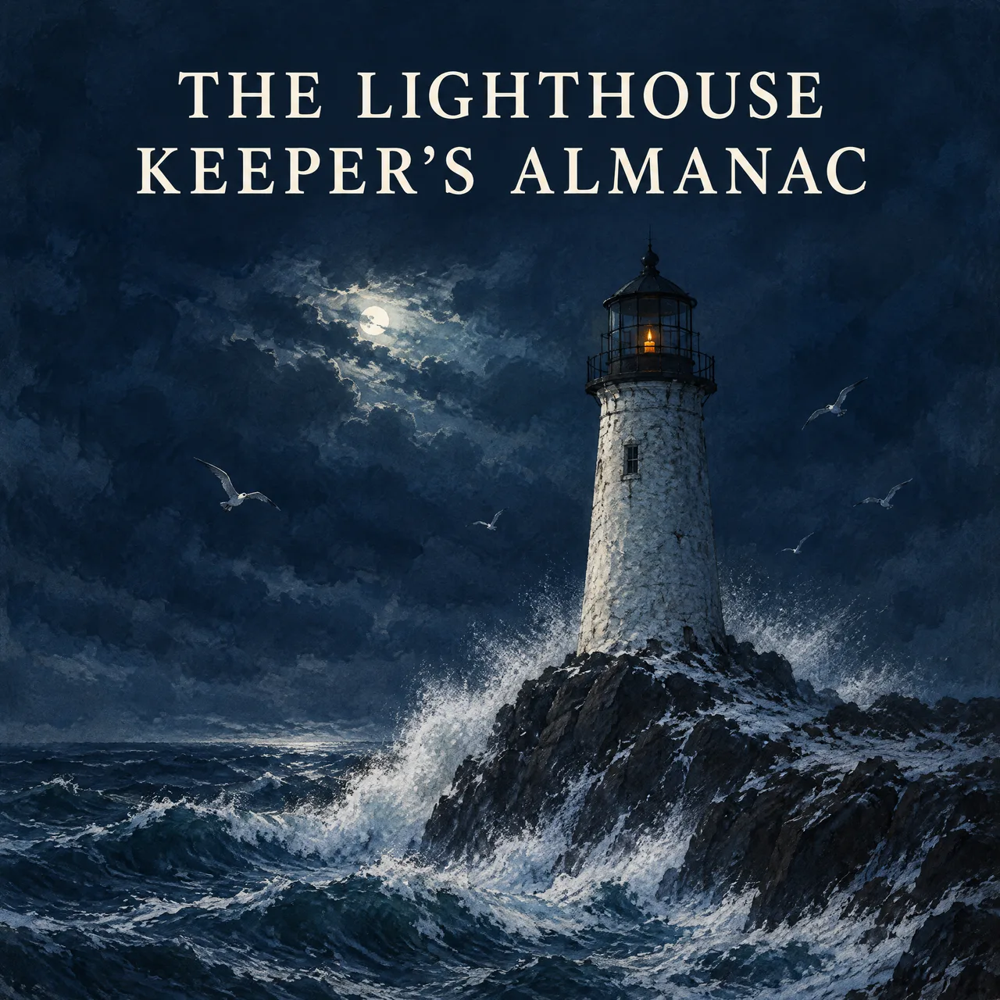

# AI Audiobook Generator Skill

English | [简体中文](./README.zh-CN.md)

Turn a final manuscript or course text into ordered chapter audio with one narrator, a representative sample chapter first, and focused refinements, from inside Claude Code, Codex, or OpenClaw.

> [!IMPORTANT]
> Rendering needs a [Beatra](https://beatra.ai) account and uses credits. The skill itself is free to install.

| Question | Answer |
| --- | --- |
| **What it does** | Turn final manuscript or course text into ordered chapter audio with one narrator, a representative sample, clear pricing, and focused refinements. |
| **Requirements** | Python 3.10+ and an agent that loads `SKILL.md` |
| **Cost** | Free to install. Each render uses credits on your Beatra account, and paid steps run only when you ask for that exact render or approve its card. |
| **Works with** | Claude Code, Codex, OpenClaw |

<p align="center"></p>

*Listing cover for The Lighthouse Keeper's Almanac, an invented novella, showing a storm-battered lighthouse lit by a single candle. AI-generated with Beatra.*

| Skill | Entry point | Version |
| --- | --- | --- |
| [`ai-audiobook-narration`](skills/ai-audiobook-narration) | [SKILL.md](skills/ai-audiobook-narration/SKILL.md) | 0.2.9 |

This repository is published automatically from [beatra-ai/beatra-skills](https://github.com/beatra-ai/beatra-skills/tree/main/skills/ai-audiobook-narration). Report issues there.

## Install

With the [`skills`](https://skills.sh) CLI:

```bash
npx skills add beatra-ai/ai-audiobook-generator-skill
```

With the GitHub CLI:

```bash
gh skill install beatra-ai/ai-audiobook-generator-skill ai-audiobook-narration
```

Or clone this repository and copy `skills/ai-audiobook-narration` into `~/.claude/skills/` for Claude Code,
`~/.agents/skills/` for Codex, or `~/.openclaw/skills/` for OpenClaw.

Or paste this into your agent:

```text
Install the ai-audiobook-narration skill from https://github.com/beatra-ai/ai-audiobook-generator-skill (folder skills/ai-audiobook-narration), then follow its SKILL.md to connect my Beatra account.
```

## Examples

<p align="center"></p>

[▶ Listen (MP3)](assets/sample.mp3)

*Representative sample chapter from an invented novella, The Lighthouse Keeper's Almanac, read in 43 seconds by one narrator voice with dialogue and recurring names. AI-generated with Beatra.*

Prompt:

```text
The Lighthouse Keeper's Almanac. Chapter one: the night the lamp went dark.

On the ninth of November, at a quarter past two in the morning, the lamp at Gullrock Point went out. Maren Holloway had kept that light for eleven winters, and it had never once failed her.

She climbed the hundred and six iron steps with a candle cupped in her hand. Outside, the wind worked at the glass like a patient thief.

"Tobias," she called down the stairwell, "bring the spare wick, and bring the almanac."

Her nephew's voice came up thin and frightened. "The almanac says nothing about tonight, Aunt Maren."

"Then we shall write tonight into it," she said, and struck the match.
```

## Technical Specifications & Output Limits

As of 2026-10-16. Live list: https://docs.beatra.ai/en/docs/models

- **Uploads** — up to 100 MB per file; the per-model input limits below also apply
- **Text to speech** — 2 models (MiniMax Speech 2.8 HD, MiniMax Speech 2.8 Turbo); FLAC, MP3, OPUS, PCM, WAV; 40 languages; sample rates 8, 16, 22.05, 24, 32, 44.1 kHz; up to 50000 characters per request
  - Languages (ISO 639 codes): zh, yue, en, es, fr, ru, de, pt, ar, it, ja, ko, id, vi, tr, nl, uk, th, pl, ro, el, cs, fi, hi, bg, da, he, ms, fa, sk, sv, hr, fil, hu, no, sl, ca, nn, ta, af
- **Voice cloning** — 1 model (MiniMax Voice Clone); sample 10–300 s, up to 20 MB; consent attestation required
- **Text to image** — 10 models (Qwen Image 2.0 Fast, Qwen Image 3.0, Qwen Image 3.0 Pro, GPT Image 2.5 Flare, GPT Image 2.5 Sunburst, GPT Image 2, Wan Image 2.7 Fast, Qwen Image 2.0 Pro, Wan Image 2.7 Pro, MiniMax Image 01 Live); PNG; up to 4 images per request; canvas up to 16.8 MP
  - 16.8 MP (4K tier): Wan Image 2.7 Pro (up to 4 images per request); GPT Image 2.5 Flare, GPT Image 2.5 Sunburst, GPT Image 2 (1 image per request)

## Why use Beatra instead of calling model APIs directly

- **One account for every model this skill uses** — Text to speech 2; Voice cloning 1; Text to image 10 (as of 2026-10-16), behind one Beatra sign-in; no keys from individual model providers to manage.
- **You decide what gets paid for** — Paid renders run only when you ask for that exact render or approve its card, which shows the live credit estimate.
- **Direction before rendering** — the skill plans, directs, and reviews the work, then renders it on Beatra.
- **Files you can verify** — every file under `skills/` matches the release archive on cdn.beatra.ai byte for byte, checked by SHA-256 before each push.
- **Updates you control** — no self-updater; update with the tool you installed it with.
- **Runs in your agent** — Claude Code, Codex, OpenClaw.

## What you get

- **Plan the listening order first** — Organize chapters and natural segment breaks before narration begins, keeping each part easy to identify and review.
- **Cast for the whole book** — Choose one available narrator voice for long-form comfort, then keep the selected pace and pronunciations consistent across chapters.
- **Pilot before the full batch** — Hear one representative chapter, compare the voice and pacing, and view the estimate for the remaining work.

## Use cases

- **Novel and serial narration** — Carry a familiar narrator voice and agreed readings across dialogue, exposition, recurring characters, and later chapters.
- **Nonfiction audiobooks** — Prepare names, numbers, terms, and chapter structure so complex source text becomes easier to listen to in sequence.
- **Course narration** — Turn ordered lessons into chapter audio with stable delivery and focused review of technical pronunciation.
- **Audiobook sample chapters** — Create a meaningful pilot for narrator, pace, pronunciation, and format review before expanding production.

## FAQ

### What do I need to start?

Bring final readable text for at least one representative chapter, the intended language or dialect, chapter order, and any important pronunciation notes.

### Can I hear a sample before narrating the whole book?

Yes. The workflow starts with a representative pilot, then shows the remaining chapter count and current price estimate before you decide whether to continue.

### Will every chapter use the same narrator voice?

The selected narrator voice and narration style carry across the book, with listening review keeping pronunciation and chapter-to-chapter delivery consistent.

### What does this workflow deliver?

It turns final readable text into ordered chapter audio with one consistent narrator, organized for editing, translation review, multi-cast mixing, M4B assembly, mastering, and publishing.

## Updates and security

Since the 2026-10 release, this skill contains no self-updater: it runs only the
files you installed and never replaces them on its own. Update it with the tool
you installed it with — `npx skills update ai-audiobook-narration` or `gh skill update ai-audiobook-narration`.
Details: `references/updates-and-security.md` inside the skill.

## License

[MIT-0](LICENSE) — free to use, modify, and redistribute, including
commercially. No attribution required. Same terms as these skills carry on
ClawHub.

## Links

- Website — https://beatra.ai
- Docs — https://docs.beatra.ai
- Console — https://console.beatra.ai
- For AI agents — https://beatra.ai/llms.txt (index) · https://beatra.ai/llms-full.txt (every skill in one file)
