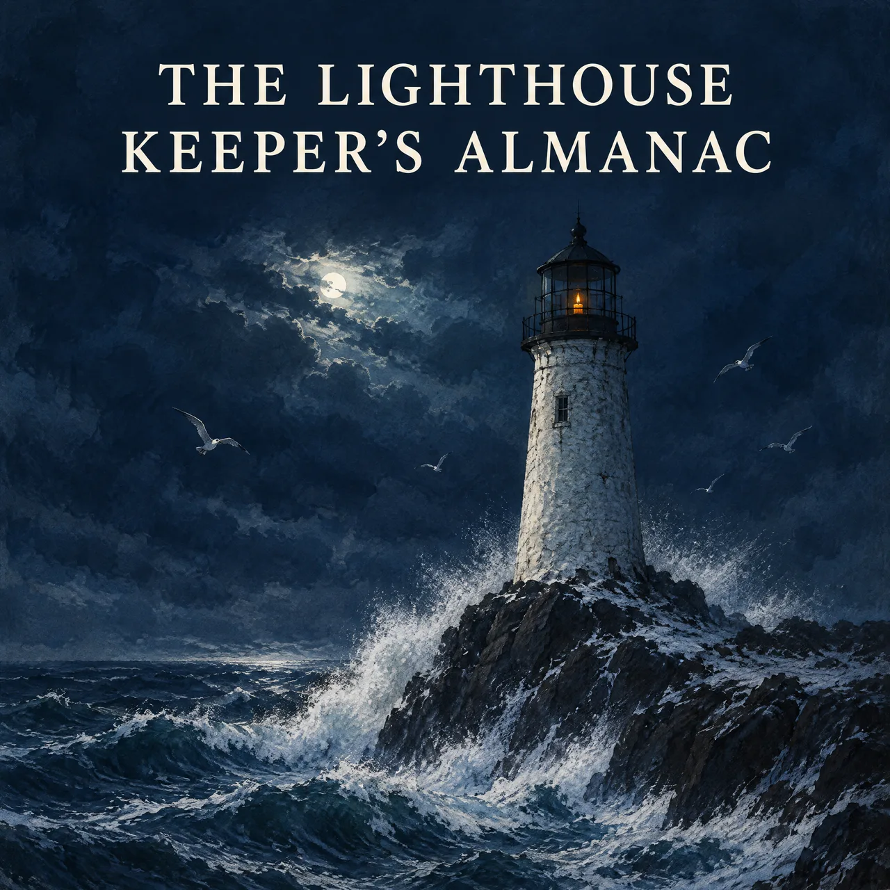
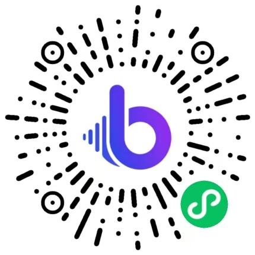

# AI Audiobook Generator Skill

[English](./README.md) | 简体中文 | [日本語](./README.ja.md)

> 👉 也看看 [AI Podcast Voiceover Skill](https://github.com/beatra-ai/ai-podcast-voiceover-skill)

把最终书稿或课程讲稿制作成按章节排列的音频，选择适合长篇聆听的旁白，先用代表性样章校准读音和节奏，再把同一声音延续到整本内容，在 Claude Code、Cursor、Codex、Windsurf、Cline 或 OpenClaw 里直接完成。

> [!IMPORTANT]
> 生成需要 [Beatra](https://beatra.ai?utm_source=github&utm_medium=flagship&utm_campaign=ai-audiobook-generator-skill) 账号并消耗积分，安装本身不收费。

| 问题 | 回答 |
| --- | --- |
| **能做什么** | 把最终书稿或课程讲稿制作成按章节排列的音频，选择适合长篇聆听的旁白，通过代表性样章校准读音和节奏，再把同一声音延续到整本内容。 |
| **底层模型** | MiniMax Speech 2.8 HD、MiniMax Speech 2.8 Turbo、Doubao Seed TTS 2.0、ElevenLabs v4 Turbo、ElevenLabs v4、MiniMax Voice Clone、Qwen Image 3.0、MiniMax H3 Image、Qwen Image 2.0 Fast、Qwen Image 3.0 Pro、GPT Image 2.5 Flare、GPT Image 2.5 Sunburst、GPT Image 2、Wan Image 2.7 Fast、Qwen Image 2.0 Pro、Wan Image 2.7 Pro |
| **运行要求** | Python 3.10+，以及能加载 `SKILL.md` 的 Agent |
| **费用** | 安装免费。每次生成消耗 Beatra 账号积分，只有你明确要求这次生成或批准确认卡后才会付费。 |
| **支持的 Agent** | Claude Code、Cursor、Codex、Windsurf、Cline、OpenClaw |

<p align="center"></p>

*虚构中篇小说《The Lighthouse Keeper's Almanac》的有声书封面，画面是风暴中只剩一支烛光的灯塔。由 Beatra AI 生成。*

| Skill | Entry point | Version |
| --- | --- | --- |
| [`ai-audiobook-narration`](skills/ai-audiobook-narration) | [SKILL.md](skills/ai-audiobook-narration/SKILL.md) | 0.3.3 |

本仓库由 [beatra-ai/beatra-skills](https://github.com/beatra-ai/beatra-skills/tree/main/skills/ai-audiobook-narration) 自动发布，问题请到那里反馈。

该 Skill 也常被称为 `ai-audiobook-generator`（安装名为 `ai-audiobook-narration`）。

## 安装

使用 [`skills`](https://skills.sh) CLI：

```bash
npx skills add beatra-ai/ai-audiobook-generator-skill
```

作为 Claude Code 插件：

```bash
claude plugin marketplace add beatra-ai/ai-audiobook-generator-skill
claude plugin install ai-audiobook-narration@ai-audiobook-generator-skill
```

作为 Codex 插件：

```bash
codex plugin marketplace add beatra-ai/ai-audiobook-generator-skill
codex plugin add ai-audiobook-narration@ai-audiobook-generator-skill
```

作为 GitHub Copilot CLI 插件：

```bash
copilot plugin marketplace add beatra-ai/ai-audiobook-generator-skill
copilot plugin install ai-audiobook-narration@ai-audiobook-generator-skill
```

作为 Gemini CLI 扩展：

```bash
gemini extensions install https://github.com/beatra-ai/ai-audiobook-generator-skill
```

作为 Antigravity CLI 插件：

```bash
agy plugin install https://github.com/beatra-ai/ai-audiobook-generator-skill
```

使用 GitHub CLI：

```bash
gh skill install beatra-ai/ai-audiobook-generator-skill ai-audiobook-narration
```

也可以克隆本仓库，把 `skills/ai-audiobook-narration` 复制到 `~/.claude/skills/`（Claude Code）、`~/.cursor/skills/`（Cursor）、`~/.agents/skills/`（Codex）、`~/.codeium/windsurf/skills/`（Windsurf）、`~/.cline/skills/`（Cline）或 `~/.openclaw/skills/`（OpenClaw）。

或者把下面这段话发给你的 Agent：

```text
从 https://github.com/beatra-ai/ai-audiobook-generator-skill 安装 ai-audiobook-narration skill（目录 skills/ai-audiobook-narration），然后按它的 SKILL.md 连接我的 Beatra 账号。
```

干净环境实测通过：Antigravity CLI (2026-11-09)。

## 效果示例

<p align="center"></p>

[▶ 试听（MP3）](assets/sample.mp3)

*虚构中篇小说《The Lighthouse Keeper's Almanac》的代表性样章，由同一位旁白声音朗读 43 秒，含对白和反复出现的人名地名。由 Beatra AI 生成。*

在你的 Agent 里这样说：

```text
把 ./almanac-manuscript.md 做成有声书，用同一个旁白声音。先从第一章选一段有代表性的试读，让我检查语速和人名读音，再继续做剩下的部分。
```

提示词：

```text
The Lighthouse Keeper's Almanac. Chapter one: the night the lamp went dark.

On the ninth of November, at a quarter past two in the morning, the lamp at Gullrock Point went out. Maren Holloway had kept that light for eleven winters, and it had never once failed her.

She climbed the hundred and six iron steps with a candle cupped in her hand. Outside, the wind worked at the glass like a patient thief.

"Tobias," she called down the stairwell, "bring the spare wick, and bring the almanac."

Her nephew's voice came up thin and frightened. "The almanac says nothing about tonight, Aunt Maren."

"Then we shall write tonight into it," she said, and struck the match.
```

## 输入与输出

| | 类型 | 格式 | 规格 |
| --- | --- | --- | --- |
| **输入** | 文本：按章节排好的最终书稿或课程讲稿 | — | — |
| **输入** | 音频：用来克隆自有旁白声音的样音（可选） | — | 10–300 秒；单个文件最大 20 MB |
| **输出** | 音频：按收听顺序排列的章节音频，全书同一旁白 | MP3 | 40 种语言 |
| **输出** | 图片：有声书封面（可选） | PNG | 单次 1 张 |

## 技术规格与输出限制

截至 2026-11-14。实时列表：https://docs.beatra.ai/zh/docs/models

- **上传** — 单个文件最大 100 MB；同时适用下方各模型的输入限制
- **语音合成** — 5 个模型（MiniMax Speech 2.8 HD、MiniMax Speech 2.8 Turbo、Doubao Seed TTS 2.0、ElevenLabs v4 Turbo、ElevenLabs v4）；FLAC、MP3、OPUS、PCM、WAV；40 种语言；采样率 8、16、22.05、24、32、44.1 kHz；单次最多 50000 字符
  - 语言（ISO 639 代码）：zh, yue, en, es, fr, ru, de, pt, ar, it, ja, ko, id, vi, tr, nl, uk, th, pl, ro, el, cs, fi, hi, bg, da, he, ms, fa, sk, sv, hr, fil, hu, no, sl, ca, nn, ta, af
- **声音克隆** — 1 个模型（MiniMax Voice Clone）；样本 10–300 秒，最大 20 MB；需提交授权声明
- **文生图** — 10 个模型（Qwen Image 3.0、MiniMax H3 Image、Qwen Image 2.0 Fast、Qwen Image 3.0 Pro、GPT Image 2.5 Flare、GPT Image 2.5 Sunburst、GPT Image 2、Wan Image 2.7 Fast、Qwen Image 2.0 Pro、Wan Image 2.7 Pro）；PNG；单次最多 4 张；画布最大 16.8 MP
  - 16.8 MP（4K 档）：MiniMax H3 Image、Wan Image 2.7 Pro（单次最多 4 张）；GPT Image 2.5 Flare、GPT Image 2.5 Sunburst、GPT Image 2（单次 1 张）

## 为什么用 Beatra，而不是直接调用模型 API

- **一个账号用到本 skill 的全部模型** — 语音合成 5；声音克隆 1；文生图 10（MiniMax Speech 2.8 HD、MiniMax Speech 2.8 Turbo、Doubao Seed TTS 2.0、ElevenLabs v4 Turbo、ElevenLabs v4、MiniMax Voice Clone、Qwen Image 3.0、MiniMax H3 Image、Qwen Image 2.0 Fast、Qwen Image 3.0 Pro、GPT Image 2.5 Flare、GPT Image 2.5 Sunburst、GPT Image 2、Wan Image 2.7 Fast、Qwen Image 2.0 Pro、Wan Image 2.7 Pro）（截至 2026-11-14），一次 Beatra 登录即可使用，不必分别管理各家模型的 key。
- **花不花钱由你决定** — 只有你明确要求这次生成，或批准显示实时积分估算的确认卡后才会付费。
- **先策划，再生成** — skill 先帮你规划、指导和检查，再在 Beatra 上生成。
- **文件可以核验** — `skills/` 下的每个文件都与 cdn.beatra.ai 上的发布归档逐字节一致，每次推送前用 SHA-256 校验。
- **更新由你掌控** — 不含自更新程序；用安装时的工具更新。
- **在你的 Agent 里运行** — Claude Code、Cursor、Codex、Windsurf、Cline、OpenClaw。

## 你能得到什么

- **先理清聆听顺序** — 在开始旁白前整理章节与自然分段，让每个音频片段都容易辨认、试听和复查。
- **为整本书选择旁白** — 选择适合长时间聆听的声音，把选好的节奏和读法延续到后续章节。
- **先听样章，再做整本** — 先试听有代表性的章节，再查看后续批次费用与章节计划。

## 适用场景

- **小说与连载播讲** — 在对白、叙述、反复出现的人物和各个章节中沿用熟悉的旁白音色与读法。
- **非虚构有声书** — 预先整理人名、数字、术语与章节结构，让信息密集的书稿更适合连续聆听。
- **课程旁白** — 把有顺序的课程和讲义做成章节音频，并重点检查专业词汇读音。
- **有声书样章试听** — 用一个有代表性的章节试听旁白、节奏、读音和格式，再规划其余章节。

## 常见问题

### 开始制作需要准备什么？

按章节排好的书稿或讲稿、朗读语言或方言，以及人名和术语的读音说明。

### 有声书怎么交付？

每章一个 MP3，按收听顺序排列，全书同一个旁白音色，还可以配一张有声书封面。

### 整本书会用同一个旁白音色吗？

每一章都用你选的旁白音色和播读方式来读，人名和术语按你定好的读法。

### 能用我自己的声音来读吗？

可以。上传一段 10 秒到 5 分钟、不超过 20 MB 的录音，各章就用从中克隆出的音色来读。

## 更新与安全

自 2026 年 10 月的版本起，本 skill 不再包含自更新程序：它只运行你安装的文件，从不自行替换。
请用安装时的工具更新——`npx skills update ai-audiobook-narration` 或 `gh skill update ai-audiobook-narration`。
详见 skill 内的 `references/updates-and-security.md`。

## 许可证

本仓库的 Skill 文件（`SKILL.md`、参考文档和脚本）与本 README 采用 [MIT-0](LICENSE) 许可：可自由使用、修改和再分发，包括商用，无需署名。

内容生成在 Beatra 云端完成，适用 [Beatra 服务条款](https://www.beatra.cn/terms?utm_source=github&utm_medium=flagship&utm_campaign=ai-audiobook-generator-skill)。

## 相关链接

- Skill 详情页 — https://www.beatra.cn/skills/ai-audiobook-narration?utm_source=github&utm_medium=flagship&utm_campaign=ai-audiobook-generator-skill
- 官网 — https://www.beatra.cn?utm_source=github&utm_medium=flagship&utm_campaign=ai-audiobook-generator-skill
- 文档 — https://docs.beatra.cn?utm_source=github&utm_medium=flagship&utm_campaign=ai-audiobook-generator-skill
- 控制台 — https://console.beatra.cn
- 给 AI Agent 读的说明 — https://www.beatra.cn/llms.txt （索引）· https://www.beatra.cn/llms-full.txt （全部 skill 合成一个文件）

- 微信小程序 — 国内用户微信扫码使用


